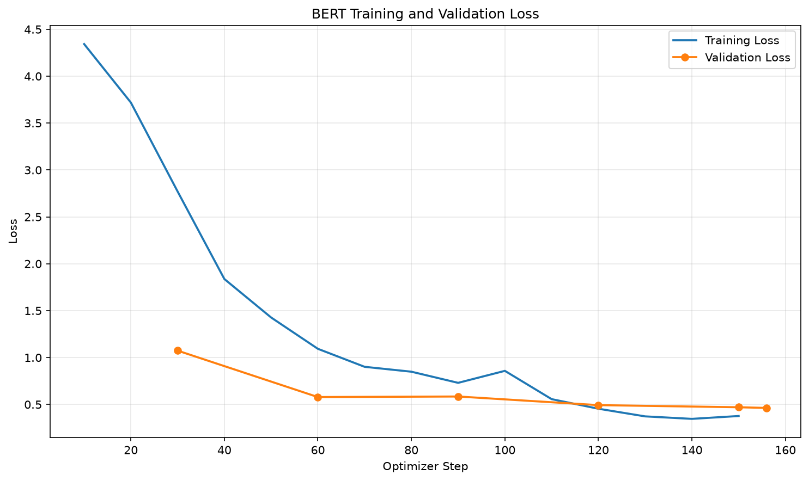
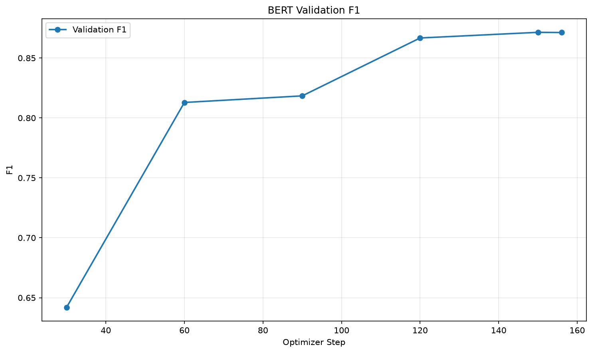

# 中文句子情緒分類

微調 `bert-base-chinese`，把一句中文判斷成 8 種情緒語調之一。

## 訓練資料來源
- [Datasets:Johnson8187/Chinese_Multi-Emotion_Dialogue_Dataset](https://huggingface.co/datasets/Johnson8187/Chinese_Multi-Emotion_Dialogue_Dataset)
- 共 4159 筆，欄位為 `text`（句子）與 `emotion`（情緒標籤）
- 以標籤分層切分：訓練集 3327 筆、驗證集 832 筆（8:2，`seed=42`）

## 基礎模型
- [google-bert/bert-base-chinese](https://huggingface.co/google-bert/bert-base-chinese)

## 安裝套件
- torch (2.6.0+cu124)
- transformers (5.19.0)
- datasets (5.1.0)
- evaluate (0.4.6)
- accelerate (1.15.0)
- scikit-learn (1.9.1)
- matplotlib (3.11.2)
- numpy (2.4.6)

完整版本請見 [requirements.txt](requirements.txt)。環境：Python 3.11、NVIDIA RTX 3080。

```
python -m venv .venv
.venv\Scripts\activate
pip install torch --index-url https://download.pytorch.org/whl/cu124
pip install transformers datasets evaluate accelerate scikit-learn matplotlib numpy
```

## 說明
這個模型把中文句子分成 8 類情緒語調。資料中的標籤是中文文字，微調時需要整數，因此 `prepare_data.py` 會把標籤依字序排序後編號為 0–7，並存成 `data/bert/labels.json`：

| 編號 | 標籤 |
|---|---|
| 0 | 厭惡語調 |
| 1 | 平淡語氣 |
| 2 | 悲傷語調 |
| 3 | 憤怒語調 |
| 4 | 疑問語調 |
| 5 | 開心語調 |
| 6 | 關切語調 |
| 7 | 驚奇語調 |

從二元分類改成多元分類的修改重點：
- `NUM_LABELS` 由 2 改為 8
- `label2id` / `id2label` 由 `labels.json` 讀入，不再寫死
- F1 由 `average="binary"` 改為 `average="macro"`

### 訓練設定
| 項目 | 值 |
|---|---|
| epochs | 3 |
| batch size | 32（gradient accumulation 2，等效 64） |
| learning rate | 1e-4 |
| warmup steps | 50 |
| weight decay | 0.01 |
| 最大長度 | 512 |

最佳模型依驗證集 `eval_loss` 挑選：`eval_loss = 0.4628`，`macro F1 = 0.8713`。

### 預測結果
| 文字 | 預測 | score |
|---|---|---|
| 我每天都能跟她一起上學，我好開心！ | 開心語調 | 0.9914 |
| 最好的朋友要離開臺灣了，以後可能不容易再見面... | 悲傷語調 | 0.9881 |
| 我覺得我快不行了... | 悲傷語調 | 0.9868 |
| 剛剛收到研究所錄取的通知書！ | 開心語調 | 0.9851 |
| 今年的冬天好像比較晚來。 | 平淡語氣 | 0.9841 |

## 執行方法
依序執行：
```
python prepare_data.py       # 讀 data/data.csv，轉標籤為整數，切分 train/valid
python train_bert.py         # 微調，最佳模型輸出到 output/bert_emotion_clf/
python plot_bert_metrics.py  # 畫 loss 與 F1 曲線
python infer_bert.py         # 預測句子，輸出「句子 => 標籤 (score)」
```

## 成果
訓練過程的驗證 loss 與 F1：




## 學習心得
這次是在 Claude Code 的一步一步帶領下完成的：它負責說明觀念與檢查，我自己動手改 `prepare_data.py`，再依指引修改其他程式。README 初稿、`infer_bert.py` 的輸出格式與程式註解的更新，是由 Claude Code 協助完成。

我在 `prepare_data.py` 親手做的部分：
- 把 `csv.reader` 改成 `csv.DictReader`，用欄位名稱 `row["text"]`、`row["emotion"]` 取值
- 用 `sorted(set(labels))` 找出 8 個不重複且順序固定的標籤
- 用 `enumerate` 與迴圈建立 `label2id`，再用 list comprehension 把 4159 個中文標籤轉成整數

過程中遇到並理解的問題：
- `KeyError: 0`、`KeyError: 1`：`DictReader` 給的是 dict，不能再用位置取值
- `label_name = set()` 後面又被 `label_name = labels` 蓋掉，等於白建
- 縮排放錯，讓 `label = ...` 跑到 `continue` 後面，永遠不會執行
- `set` 沒有固定順序，所以編號前一定要先 `sorted`，否則每次執行編號都可能不同

## 專案結構
```
data/
  data.csv                 原始資料
  bert/                    train.jsonl、valid.jsonl、labels.json
output/bert_emotion_clf/   微調後的最佳模型與訓練曲線（不含 checkpoint-*）
prepare_data.py            資料前處理
train_bert.py              微調
plot_bert_metrics.py       畫圖
infer_bert.py              預測
requirements.txt
README.md
```

模型檔 `model.safetensors`（約 409 MB）以 Git LFS 管理，clone 前請先安裝 [Git LFS](https://git-lfs.com/)。
